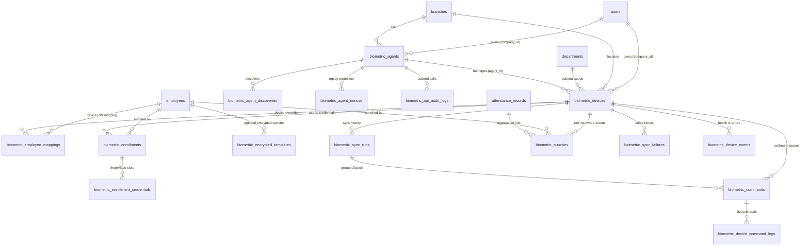

# Biometric Attendance System — Normalized Database Design

This document describes the normalized relational database schema for the HRMS Biometric Attendance module. All biometric tables adapt to existing HRMS tables (`users`, `employees`, `branches`, `departments`, `shifts`, `attendance_policies`, `attendance_records`, `attendance_regularizations`) without creating duplicate employee or attendance tables.

---

## 1. Entity Mapping (Phase 10 Normalized Entities)

| # | Logical Entity | Physical Table(s) | Tenant Scope | Key Constraints & Foreign Keys |
|---|---|---|---|---|
| 1 | **Biometric Devices** | `biometric_devices` | `company_id -> users.id` | Unique `(company_id, serial_number)` & `(company_id, device_identifier)`; FKs to `branches`, `departments`, `biometric_agents`, `users`; indexes `(company_id, is_active, connection_status)`, `(company_id, branch_id)`, `(agent_id, is_active)`. |
| 2 | **Biometric Device Agents** | `biometric_agents` (+ `biometric_agent_discoveries`, `biometric_agent_nonces`) | `company_id -> users.id` | Unique `(company_id, agent_identifier)` & `(agent_identifier)`; FKs to `users`, `branches`; replay nonce unique `(agent_id, nonce_hash)`. |
| 3 | **Employee Device Mappings** | `biometric_employee_mappings` (+ hardware mirror `biometric_device_users`) | `company_id -> users.id` | Adapts to `employees` (never duplicates it). Unique `(company_id, device_id, device_user_id)` & `(company_id, employee_id, device_id)`; FKs to `users`, `employees`, `biometric_devices`; supports device-specific & company-wide (`device_id IS NULL`) mappings. |
| 4 | **Biometric Enrollments** | `biometric_enrollments` (+ `biometric_enrollment_credentials`, isolated `biometric_encrypted_templates`) | `company_id -> users.id` | Unique `(employee_id, device_id)` & `(enrollment_reference)`; FKs to `users`, `employees`, `biometric_devices`, `biometric_commands`. Raw fingerprint/face images are never stored. |
| 5 | **Biometric Attendance Logs** | `biometric_punches` (canonical) & `biometric_attendance_logs` (legacy adapted in-place) | `company_id -> users.id` | `biometric_punches` has 3 unique dedupe keys: `(dedupe_hash)`, `(device_id, original_device_log_id)`, `(device_id, idempotency_key)`; FKs to `users`, `biometric_devices`, `employees`, `biometric_sync_runs`, `attendance_records`. Legacy `biometric_attendance_logs` adapted in-place with nullable `company_id`, `device_id`, `punch_id` FKs. |
| 6 | **Biometric Sync Logs** | `biometric_sync_runs`, `biometric_sync_failures`, `biometric_device_events`, `biometric_api_audit_logs` | `company_id -> users.id` | FKs to `users`, `biometric_devices`, `biometric_agents`, `biometric_sync_runs`, `biometric_punches`; composite retry/history/audit indexes `(company_id, status, started_at)`, `(company_id, status, next_retry_at)`, `(company_id, created_at)`. |
| 7 | **Biometric Device Commands** | `biometric_commands` (canonical) & `biometric_device_commands` (legacy adapted in-place) | `company_id -> users.id` | FKs to `users`, `biometric_devices`, `biometric_agents`, `biometric_sync_runs`, `employees`; dispatch index `(device_id, status, priority, id)` and `(company_id, status, created_at)`. Legacy `biometric_device_commands` adapted with `company_id` & `device_id` FKs. |
| 8 | **Device Command Logs** | `biometric_device_command_logs` | `company_id -> users.id` | Append-only lifecycle & retry audit log (`queued -> sent -> acknowledged / failed / expired / cancelled`, attempt number, return code, latency ms, redacted response). FKs to `users`, `biometric_commands`, `biometric_devices`, `biometric_agents`; indexes `(command_id, occurred_at)`, `(company_id, event, occurred_at)`, `(device_id, occurred_at)`. |

---

## 2. Entity-Relationship Diagram

---

## 3. Migration Timeline

All schema changes are incremental, idempotent, and cleanly reversible:
1. `2026_11_20_000001_create_biometric_devices_table.php`
2. `2026_11_20_000002_create_biometric_sync_runs_table.php`
3. `2026_11_20_000003_create_biometric_commands_table.php`
4. `2026_11_20_000004_create_biometric_device_events_table.php`
5. `2026_11_20_000005_seed_biometric_device_permissions.php`
6. `2026_11_20_000006_add_device_communication_tables.php`
7. `2026_11_20_000007_create_biometric_agents_tables.php`
8. `2026_11_20_000008_create_biometric_enrollments_tables.php`
9. `2026_11_20_000009_create_biometric_attendance_sync_tables.php`
10. `2026_11_20_000010_add_attendance_processing_rules_columns.php`
11. `2026_11_20_000011_create_biometric_api_security_tables.php`
12. `2026_11_20_000012_normalize_biometric_database_schema.php`
